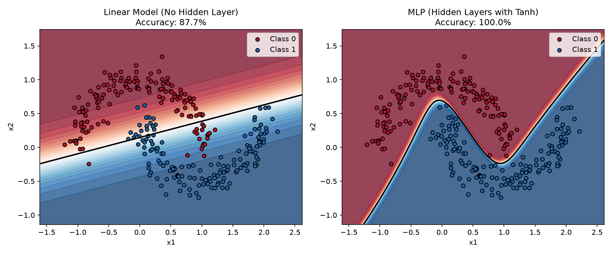

# Inside the Backward Pass — Neural Network from Scratch

A minimal neural network library built from scratch using **NumPy and Matplotlib only** (no PyTorch, TensorFlow, or autograd).

## Project Files

- `nn.py` — Core engine (`Linear`, `Sigmoid`, `ReLU`, `Tanh`, `MSELoss`, `BCELoss`, `Network`).
- `phase1_hand_trace.md` — Step-by-step Phase 1 hand calculation (`2 -> 2 (Sigmoid) -> 1`, `MSELoss`).
- `phase1_verify.py` — Runs the exact Phase 1 network and asserts every forward value and gradient matches the hand trace.
- `grad_check.py` — Numerical gradient checking via central finite differences (`rel_error < 1e-6`).
- `train_nonlinear.py` — Trains a linear baseline vs. an MLP on a pure-NumPy 2D Two Moons dataset (80/20 train/test split) and saves plots.
- `REPORT.md` — Full technical report summarizing all phases and results.

## How to Run

```bash
pip install numpy matplotlib
python phase1_verify.py
python grad_check.py
python train_nonlinear.py
```

## Results

### Phase 1 & Phase 3 Verification
- `phase1_verify.py`: All forward values (`z1`, `a1`, `y_hat`, `loss`) and backward gradients (`dW2`, `db2`, `da1`, `dz1`, `dW1`, `db1`, `dx`) match the hand trace (`[PASS]`).
- `grad_check.py`: All parameters across `Linear`, `Sigmoid`, `ReLU`, `Tanh`, `MSELoss`, and `BCELoss` pass with relative error between `1.438e-11` and `1.378e-09` (well below `1e-6`).

### Non-Linear Classification (Two Moons, 240 Train / 60 Test)

| Model | Final Loss | Train Accuracy | Test Accuracy |
| :--- | :---: | :---: | :---: |
| Linear Baseline (`2 -> 1`) | `0.2681` | `87.5%` | `88.3%` |
| MLP with Hidden Layers (`2 -> 16 -> 16 -> 1`) | `0.0022` | `100.0%` | `100.0%` |

| Decision Boundaries | Training Loss |
| :---: | :---: |
|  |  |
